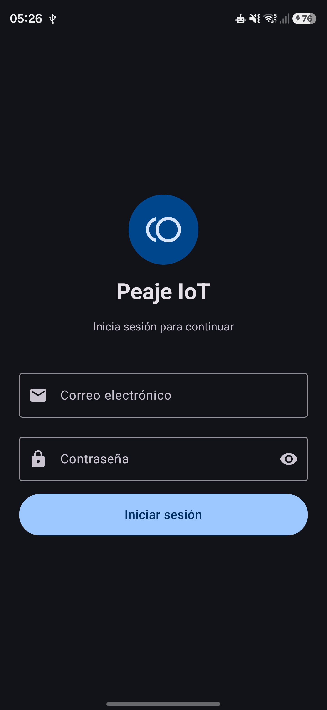
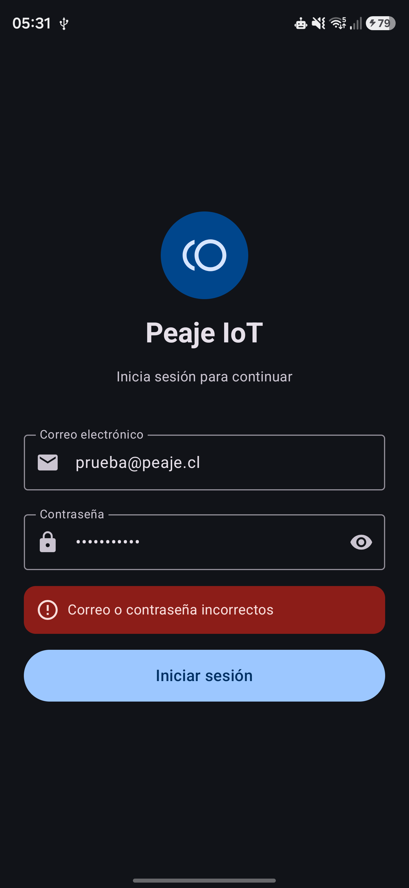
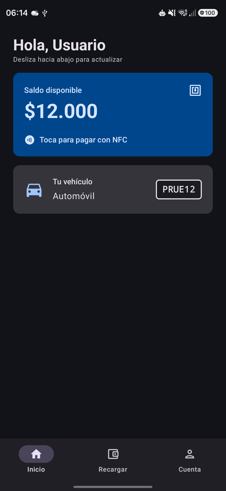
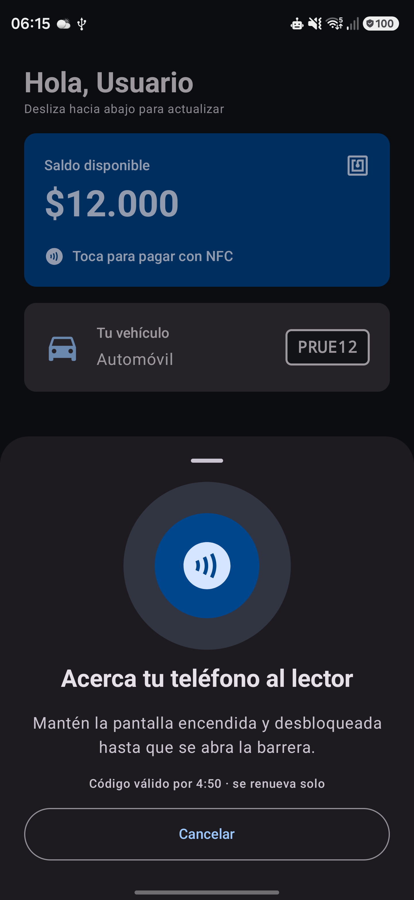
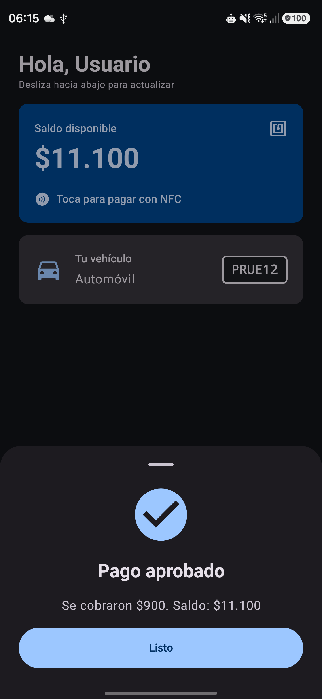
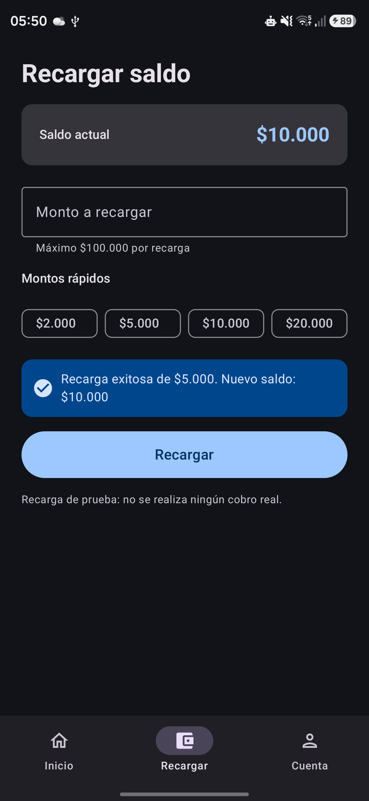
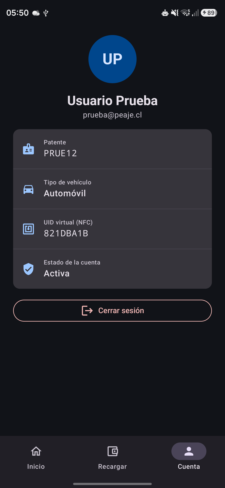

# Sumativa Unidad 2 — Aplicaciones Móviles para IoT (TI3042)

**Proyecto:** Peaje IoT — telepeaje con barrera automática, pago con tarjeta RFID o con el celular (NFC)
**Repositorio:** https://github.com/MrEmpathy/peaje-oit

Respuestas en el orden de la guía de aprendizaje. Las capturas están en `docs/capturas/` y el código en
`app/` (Android), `backend/` (servidor) y `firmware/` (ESP32).

---

## Paso 1: Definir el proyecto

### 1.1 Identificación de la problemática

En un peaje tradicional el conductor debe detenerse a pagar en efectivo, lo que genera filas, demoras y manejo de
dinero. El proyecto automatiza el cobro: el conductor se identifica en la barrera con una **tarjeta RFID** o con su
**celular (NFC)**, el sistema descuenta la tarifa de su saldo y la barrera se abre sola.

**Dispositivos que se conectan**

| Dispositivo | Rol |
|---|---|
| Celular Android (app Peaje IoT) | Cuenta del usuario, saldo, recargas y medio de pago NFC |
| ESP32 en la garita | Lector RFID/NFC, servo de la barrera, LCD y sensor ultrasónico (HC-SR04) que detecta el paso del vehículo |
| Server | Servidor central: API REST, broker MQTT, lógica de cobro y base de datos |

**Objetivo de la comunicación:** que la lectura en la garita llegue al servidor, que este valide al usuario y su saldo,
cobre la tarifa según el tipo de vehículo y le ordene a la barrera abrir o no, en menos de un segundo; y que el usuario
vea desde la app su saldo y el resultado de cada paso.

**Funcionalidades clave de la app**

| Funcionalidad | Tipo de interacción |
|---|---|
| Inicio de sesión con correo y contraseña | Autenticación contra el backend |
| Ver saldo y vehículo (patente y tipo) | Recibir datos del servidor |
| Pagar el peaje acercando el celular al lector | Enviar una credencial al dispositivo IoT (NFC) y recibir el resultado del cobro |
| Recargar saldo | Enviar datos al servidor |
| Ver datos de la cuenta y cerrar sesión | Gestión de la sesión |

### 1.2 Selección de herramientas de desarrollo

**App Android**

| Herramienta / biblioteca | Uso |
|---|---|
| Android Studio + **Kotlin** | Lenguaje e IDE oficiales de Android |
| **Jetpack Compose** + Material Design 3 | Interfaz declarativa, estándar actual de diseño de Android (tema claro y oscuro) |
| Navigation Compose | Barra de navegación inferior (Inicio, Recargar, Cuenta) |
| ViewModel + StateFlow (arquitectura MVVM) | Separar la interfaz de la lógica; el estado sobrevive a rotaciones de pantalla |
| Retrofit 2 + Gson + OkHttp | Consumo de la API REST (JSON) y envío automático del token JWT |
| SharedPreferences | Guardar la sesión (token JWT y datos del usuario) |
| Android NFC — Host Card Emulation (`HostApduService`) | El celular emula una tarjeta sin contacto para pagar en la barrera |
| JUnit 4 | Pruebas unitarias del protocolo NFC |

**Servidor y dispositivo IoT**

| Herramienta | Uso |
|---|---|
| FastAPI (Python) | API REST con validación de datos y documentación automática (`/docs`) |
| **MySQL / MariaDB** | Base de datos de usuarios, credenciales, garitas, tarifas, transacciones y recargas |
| Eclipse Mosquitto (MQTT) | Mensajería entre las garitas (ESP32) y el servidor |
| Docker Compose | Despliegue reproducible de broker, API y worker en el server |
| ESP32 (Arduino) + PubSubClient, MFRC522 / PN532, ESP32Servo, LiquidCrystal I2C | Firmware de la garita |

**Justificación del almacenamiento: API externa con MySQL.**
- **Un solo saldo para todos los dispositivos.** El saldo debe ser el mismo para la app, el ESP32 de cada garita y
  cualquier otro celular del usuario. Una base local (SQLite) no se comparte entre dispositivos y no la puede consultar el ESP32.
- **El celular nunca accede directo a la base de datos.** Todo pasa por la API, que valida permisos; las credenciales de la
  base no salen del servidor.
- **Interoperabilidad.** Los datos de los sensores (lecturas en la barrera) se guardan en `transacciones_peaje` y se
  consultan con JSON por HTTP: los usan la app, el ESP32 (vía MQTT) y cualquier otro cliente.
- **Firebase se descartó** porque hace depender el proyecto de un servicio externo y complica la integración con el
  ESP32 y el cobro atómico en la base de datos.

### 1.3 Revisión con el docente

Resumen para validar con el docente:

- **Problemática:** cobro automático de peaje con barrera.
- **Dispositivos:** app Android, ESP32 con lector y barrera, server central.
- **Comunicación:** Wi-Fi + HTTP REST (app ↔ servidor), MQTT (ESP32 ↔ servidor), NFC (celular ↔ lector).
- **Autenticación:** API con MySQL, contraseñas cifradas con bcrypt y sesiones con JWT.
- **Funcionalidades:** login, saldo, pago NFC, recargas y cuenta.

> Pendiente: registrar aquí la fecha y los comentarios de la revisión.

---

## Paso 2: Diseñar la solución

### 2.1 Método de comunicación inalámbrica

```
App Android ──Wi-Fi / HTTP + JWT──► API REST (FastAPI) ──┐
     │                                                     ├──► MySQL / MariaDB
     └──NFC (token de un solo uso)──► ESP32 + lector ──Wi-Fi / MQTT──► Mosquitto ◄──► worker de cobro
                                          │
                                  Servo / LCD / HC-SR04
```

| Enlace | Tecnología | Justificación (distancia, consumo, estabilidad) |
|---|---|---|
| App ↔ servidor | **Wi-Fi + HTTP REST** (JSON) | El celular ya tiene Wi-Fi; con el túnel HTTPS también funciona con datos móviles, a cualquier distancia. HTTP es el estándar para consultas puntuales (saldo, recargas) y no mantiene conexiones abiertas, así que consume poca batería. |
| ESP32 ↔ servidor | **Wi-Fi + MQTT** | Protocolo publicar/suscribir muy liviano, pensado para microcontroladores. La conexión permanece abierta con *keepalive*, así que la orden de abrir llega en milisegundos. Usa QoS 1, reconexión automática y un `id` por lectura que evita confundir respuestas atrasadas. Alcance de la red Wi-Fi local. |
| Celular ↔ barrera | **NFC** (ISO 14443-4, Host Card Emulation) | Alcance de unos 4 cm: el cobro solo ocurre si el usuario acerca a propósito su teléfono, sin riesgo de cobrar a otro auto de la fila. Consumo mínimo y no requiere emparejar dispositivos. |

**Por qué no Bluetooth para pagar:** su alcance de 10 metros o más haría ambiguo qué vehículo está en la barrera, y el
emparejamiento agrega pasos al usuario. NFC obliga a una acción física y cercana, igual que una tarjeta bancaria sin contacto.

### 2.2 Pantalla de login y sistema de autenticación

**Opción elegida: API con MySQL.**

| Criterio | Justificación |
|---|---|
| Seguridad | La contraseña se guarda solo como hash **bcrypt** en el servidor. El celular guarda un **token JWT** firmado que expira, nunca la contraseña. El login tiene límite de intentos (5 por minuto por IP). |
| Escalabilidad | Una sola cuenta funciona en varios celulares y garitas; agregar usuarios o garitas no requiere cambiar la app. |
| Facilidad | La misma API que autentica entrega el saldo, las recargas y los tokens de pago, sin servicios adicionales. |

**Flujo:**
1. La app envía `POST /login` con el correo y la contraseña.
2. El servidor verifica el hash y que la cuenta esté activa, y responde con el token JWT y los datos del usuario.
3. La app guarda la sesión y envía `Authorization: Bearer <token>` en cada petición.
4. Si el servidor responde 401 (token inválido o expirado), la app cierra la sesión y vuelve al login.

**Validaciones de la pantalla:** campos vacíos, formato del correo y mensajes en español para los errores del servidor
(credenciales incorrectas, cuenta inactiva, demasiados intentos, sin conexión).

### 2.3 Diseño de la interfaz (mockup)

Navegación: **Login** → pantalla principal con **barra inferior** de tres pestañas.

| Pantalla | Contenido | Interacción con el IoT |
|---|---|---|
| Login | Correo, contraseña (con botón para mostrarla) y botón "Iniciar sesión" | — |
| **Inicio** | Saludo, **tarjeta de saldo** y vehículo (patente y tipo). Deslizar hacia abajo actualiza los datos. | Tocar la tarjeta de saldo abre el **pago NFC** |
| Pago NFC (hoja inferior) | Animación "Acerca tu teléfono al lector", tiempo de validez del código y resultado (aprobado o motivo del rechazo, con el saldo nuevo) | El teléfono entrega el token al lector; la app muestra el resultado real del cobro |
| Recargar | Saldo actual, monto, botones rápidos ($2.000 a $20.000) | — |
| Cuenta | Nombre, correo, patente, tipo de vehículo, UID NFC, estado de la cuenta y "Cerrar sesión" (con confirmación) | — |

| Login | Error de login | Inicio |
|---|---|---|
|  |  |  |

| Pago NFC | Pago aprobado | Recargar | Cuenta |
|---|---|---|---|
|  |  |  |  |

**Cómo se visualizan los datos capturados:** cada lectura en la barrera se guarda como una transacción, con el método de
pago, la garita, el carril, la patente, la tarifa cobrada y el saldo antes y después. La app muestra el saldo resultante
en Inicio y el resultado de cada pago en la hoja de pago NFC.

### 2.4 Revisión con el docente

Presentar al docente:
- el diagrama de la sección 2.1;
- la tabla de autenticación de la sección 2.2;
- las capturas de la sección 2.3.

> Pendiente: registrar aquí la fecha y los comentarios de la revisión.

---

## Paso 3: Construir la aplicación

### 3.1 Pantalla de login y autenticación de usuarios

Implementado en la app (`app/app/src/main/java/com/peaje/app/`):

| Archivo | Función |
|---|---|
| `ui/login/LoginScreen.kt`, `LoginViewModel.kt` | Pantalla, validaciones y estado de carga y errores |
| `data/PeajeRepository.kt` | Llama a `POST /login`, traduce los errores a mensajes y expone el usuario actual al resto de la app |
| `data/SessionManager.kt` | Guarda y borra la sesión en SharedPreferences |
| `data/remote/PeajeApi.kt` | Cliente Retrofit; agrega el token JWT a cada petición |
| `MainActivity.kt` | Muestra el login o la pantalla principal según haya sesión |

En el backend (`backend/api_peaje.py`): `POST /registro` (crea la cuenta con patente y tipo de vehículo) y
`POST /login`, con contraseñas bcrypt y tokens JWT HS256.

### 3.2 Conexión con los dispositivos IoT y almacenamiento de datos

**Conexión con la barrera (ESP32):**
1. El ESP32 lee una tarjeta (UID) o un celular (token) y lo publica por MQTT en
   `peaje/<garita>/<carril>/lectura` o `.../token`.
2. El worker (`backend/worker_mqtt.py`) valida la garita, la credencial y al usuario. Luego obtiene la tarifa según la garita
   y el **tipo de vehículo**, revisa el saldo y descuenta **en una sola transacción de base de datos** (bloqueando el registro
   del usuario, para que dos lecturas simultáneas no cobren dos veces).
3. Responde en `peaje/<garita>/<carril>/orden` con `ABRIR` o `DENEGAR` y el motivo. El ESP32 mueve el servo y muestra el
   resultado en la LCD; el sensor ultrasónico detecta cuándo pasó el auto para cerrar la barrera.

**Pago con el celular (NFC):** al tocar la tarjeta de saldo, la app pide al servidor un **token de un solo uso**
(`POST /usuario/token-nfc`, vigente 5 minutos y renovado automáticamente) y lo entrega al lector cuando este envía el
comando `SELECT AID F05045414A4501`. Luego consulta `GET /usuario/historial` hasta ver la transacción y muestra el resultado.

**Almacenamiento (MySQL/MariaDB, `backend/db/schema.sql`):**

| Tabla | Datos |
|---|---|
| `usuarios` | Cuenta, hash de la contraseña, saldo, patente y tipo de vehículo |
| `credenciales` | UIDs de tarjetas físicas y UID virtual de cada usuario |
| `garitas`, `tipos_vehiculo`, `tarifas` | Tarifa por garita y tipo de vehículo |
| `transacciones_peaje` | **Cada lectura de los sensores**: método, garita, carril, patente, tipo, tarifa, saldo antes y después, estado |
| `recargas` | Historial de recargas |
| `tokens_nfc_usados` | Tokens ya usados, para impedir que se reutilicen |

**Consulta desde la app:** `GET /usuario/saldo`, `GET /usuario/historial`, `GET /usuario/recargas`,
`GET /usuario/tarjetas`, `GET /tarifas`. Los datos se ven al instante en la app: el saldo se actualiza al entrar a Inicio
y al deslizar hacia abajo, y el resultado del pago aparece en cuanto el servidor registra la transacción.

### 3.3 Medidas de seguridad IoT (ISO/IEC 27400)

| Práctica | Implementación |
|---|---|
| **Cifrado de credenciales** | Contraseñas con hash **bcrypt** (nunca en texto plano). Tokens de pago NFC firmados con **HMAC-SHA256**. Las claves del sistema van en `.env`, fuera del código. |
| **Autenticación y sesiones** | JWT firmado con expiración; si expira, la app cierra la sesión sola. |
| **Control de acceso** | Cada endpoint protegido solo opera sobre la cuenta del token. El broker MQTT exige usuario y clave, con **ACL por dispositivo**: cada ESP32 solo publica y lee los topics de su garita, y solo el servidor puede ordenar `ABRIR` (probado: un ESP32 que intenta publicar `ABRIR` recibe *Not authorized*). |
| **Protección contra fraude** | El token NFC dura 5 minutos, sirve una sola vez (se rechaza si se reutiliza), y el teléfono solo lo entrega mientras el usuario tiene abierta la pantalla de pago y el equipo desbloqueado. Si llega una segunda lectura en 10 segundos, no se cobra de nuevo. |
| **Fallo seguro** | Ante un error del servidor o sin respuesta en 5 segundos, la barrera **no** se abre. |
| **Validación de datos** | Formato de correo, largo de contraseña, patente, UID y montos validados en el servidor y en la app. Límite de intentos de login. |
| **Integridad del saldo** | Cobros y recargas en transacciones atómicas; el saldo no puede quedar negativo (restricción `CHECK`). |
| **Permisos mínimos en Android** | Solo `INTERNET` y `NFC`. Sin respaldo automático de datos (`allowBackup=false`). El tráfico HTTP sin cifrar está bloqueado salvo hacia la IP del servidor. Los registros nunca incluyen contraseñas ni tokens. |
| **Conexiones seguras (HTTPS/TLS)** | La API puede exponerse por **HTTPS** mediante el túnel de Cloudflare (`peaje.apiUrl=https://...`). Ver la sección de brechas. |

### 3.4 Pruebas de funcionamiento

| Prueba | Resultado |
|---|---|
| Login: campos vacíos, correo inválido, contraseña incorrecta, login correcto | ✅ Mensajes correctos; entra a Inicio con saldo y vehículo |
| Sesión: reabrir la app, cerrar sesión, token inválido o expirado | ✅ Se mantiene, se cierra con confirmación, vuelve al login ante un 401 |
| Navegación: Inicio, Recargar y Cuenta; botón atrás | ✅ |
| Recargas: sin monto, sobre el máximo, monto rápido | ✅ Validaciones y saldo actualizado en todas las pantallas |
| Pago NFC: hoja de pago, token, cuenta regresiva, resultado | ✅ Token registrado en Android (`dumpsys nfc`); lectura del lector simulada por MQTT → la app mostró "Pago aprobado" con el saldo nuevo |
| Cobro por tipo de vehículo (moto 450, auto 900, camión 2.500, sin tarifa) | ✅ Montos correctos; `TARIFA_NO_DEFINIDA` cuando falta la tarifa |
| Seguridad MQTT: sin usuario, clave incorrecta, publicar `ABRIR`, otra garita | ✅ Todos rechazados |
| Anti doble cobro y token reutilizado | ✅ Abre sin cobrar / `TOKEN_REUTILIZADO` |
| Consistencia de datos | ✅ Lo recargado menos lo cobrado coincide con el saldo de cada usuario |
| Pruebas unitarias de la app (protocolo NFC y mensajes de resultado) | ✅ 10 de 10 |
| Firmwares del ESP32 (RC522 y PN532) | ✅ Compilan sin advertencias |

Probado en un Samsung Galaxy S26 Ultra con Android 16, contra el server real.

---

## Paso 4: Presentación y validación

### 4.1 Guion de la demostración en clase

1. **Autenticación y gestión de usuarios**
   - Mostrar un login fallido y uno correcto.
   - Mostrar que la sesión se mantiene al reabrir la app y cerrar sesión desde Cuenta.
   - En la base de datos, mostrar que la contraseña está guardada como hash bcrypt.
2. **Conexión entre la app y el dispositivo IoT**
   - En Inicio, tocar la tarjeta de saldo y acercar el celular al lector (PN532), o pasar una tarjeta RFID.
   - La barrera se abre, la LCD muestra el saldo y la app muestra "Pago aprobado".
3. **Almacenamiento y consulta de datos**
   - Mostrar la transacción en la base de datos (`transacciones_peaje`) y el saldo actualizado en la app.
   - Hacer una recarga desde la app y mostrar la tabla `recargas`.
4. **Medidas de seguridad**
   - Mostrar que un dispositivo sin clave no puede conectarse a MQTT.
   - Mostrar que un token reutilizado se rechaza y que la barrera no se abre sin respuesta del servidor.

Comandos útiles: `./live_log.sh` en el servidor (registros en vivo) y la documentación de la API en `http://<ip>:8000/docs`.

### 4.2 Evaluación del docente

| Criterio | Evidencia en el proyecto |
|---|---|
| **2.1.1** Herramientas de desarrollo y estándar de diseño Android | Kotlin, Jetpack Compose, Material Design 3, arquitectura MVVM, Navigation (sección 1.2) |
| **2.1.2** App Android con conexión inalámbrica pertinente | Wi-Fi/HTTP con el servidor y NFC con la barrera, justificados en la sección 2.1 |
| **2.1.3** Estándar ISO de seguridad IoT | Medidas según ISO/IEC 27400 (sección 3.3) |
| **2.1.4** Interconexión entre aplicaciones móviles por conexión inalámbrica | Varios celulares con la app comparten la misma cuenta y el mismo saldo en tiempo real a través del servidor (Wi-Fi). Ver brecha 1. |

---

## Indicaciones de entrega

1. Subir el proyecto a un repositorio de GitHub (carpetas `app/`, `backend/`, `firmware/`, `docs/` y los README).
2. **Antes de subirlo, no incluir secretos:**
   - `backend/.env` ya está en `backend/.gitignore`. Confirmar con `git status` que no aparece.
   - En `firmware/*/*.ino`, la clave MQTT debe quedar como `CLAVE_MQTT_DE_LA_GARITA`, y el Wi-Fi como valores de ejemplo.
3. Crear un bloc de notas (`.txt`) con el link del repositorio y subirlo a la tarea del AAI **antes de que termine la clase** del día de la evaluación.

---

## Brechas pendientes respecto a la guía

| # | Punto de la guía | Estado | Propuesta |
|---|---|---|---|
| 1 | *"Interactuar al menos dos dispositivos Android"* / criterio 2.1.4 | Hoy dos celulares se relacionan **a través del servidor**, no directamente entre sí | Agregar en la app un **modo "Lector de garita"**: un segundo Android lee por NFC el token del primero (modo lector `IsoDep`) y lo envía al servidor. Así se demuestra la interconexión directa celular↔celular, y además se puede probar el pago NFC sin el PN532 |
| 2 | *"Uso de conexiones seguras (HTTPS, TLS)"* | En la red local la API usa HTTP y MQTT va sin TLS | Usar el túnel HTTPS de Cloudflare para la app y habilitar TLS (puerto 8883) en Mosquitto |
| 3 | *"Cifrado de datos sensibles"* en el teléfono | El token JWT se guarda en SharedPreferences sin cifrar | Guardarlo cifrado con Android Keystore. Reducir la duración del JWT (hoy `JWT_EXPIRATION_HOURS=2400`, unos 100 días) |
| 4 | *"Consultar los datos capturados"* | El historial existe en la API, pero la app aún no tiene una pantalla que lo liste | Agregar una pantalla "Historial" con cada paso por el peaje |
| 5 | Gestión de usuarios desde la app | El registro (con patente y tipo) y la vinculación de tarjetas existen en la API, pero no en la app | Pantalla de registro y opción en Cuenta para vincular tarjetas leyéndolas con el NFC del celular |
| 6 | Pago NFC con el lector real | Probado con lectura simulada; falta probarlo con el PN532 | Probarlo al recibir el PN532 (`firmware/CONFIGURACION.md`) |
| 7 | Revisiones con el docente (pasos 1.3 y 2.4) | Pendientes de registrar | Anotar fecha y comentarios |
