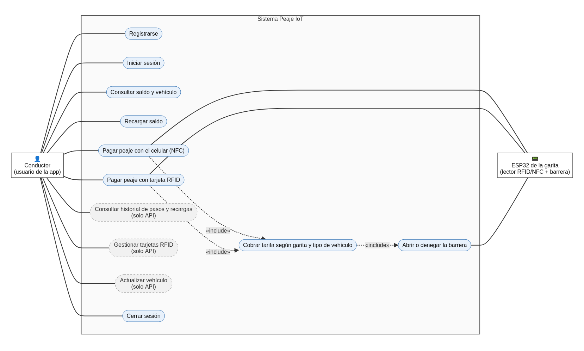
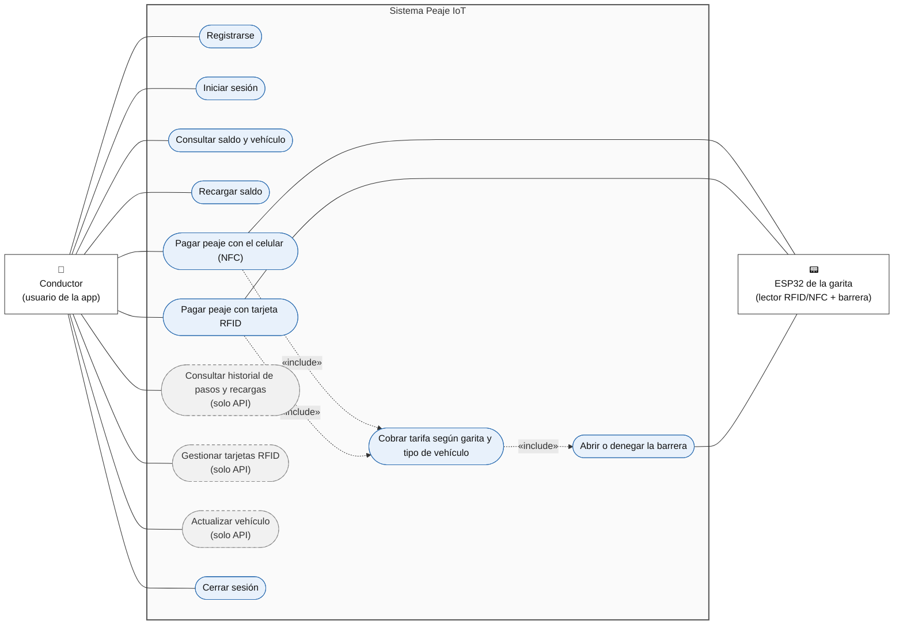
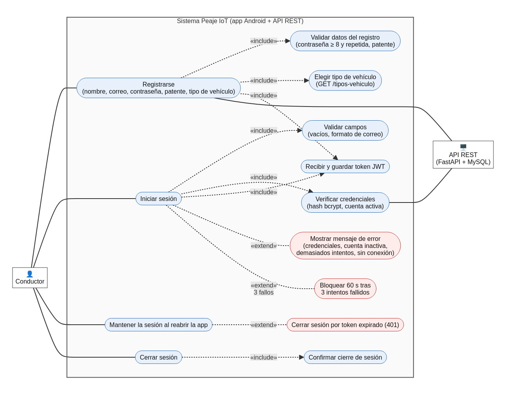
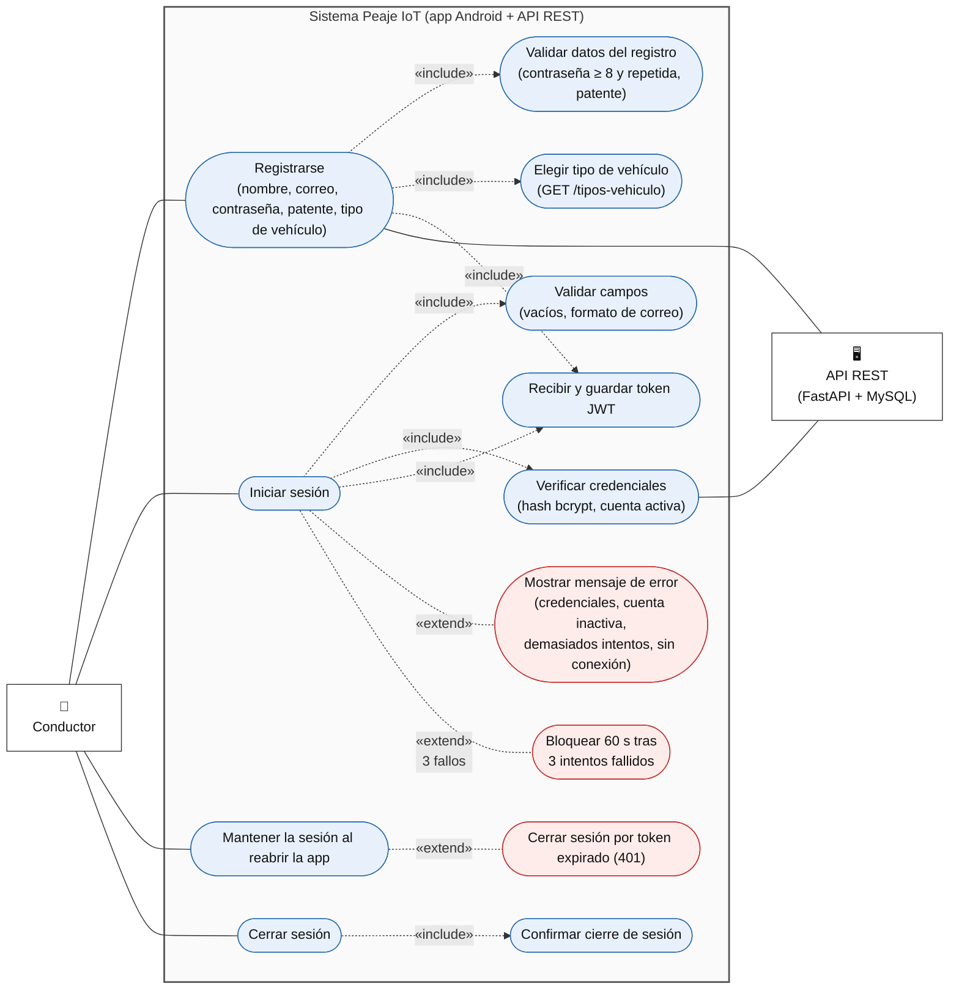
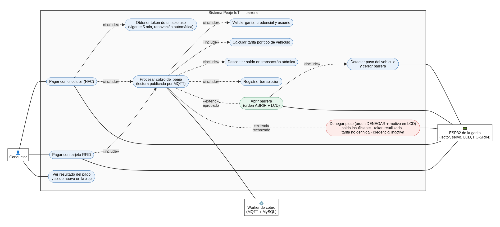
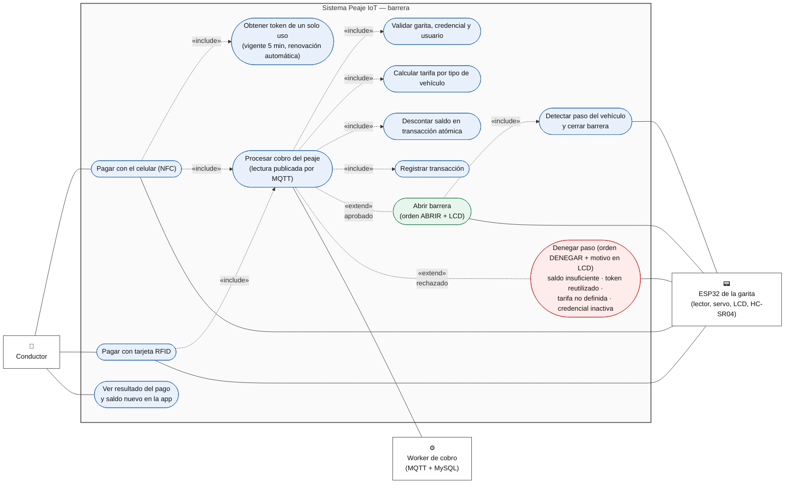
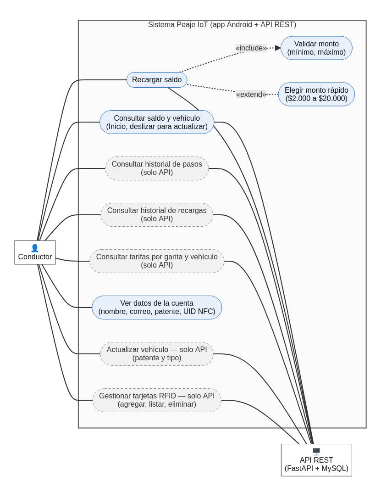
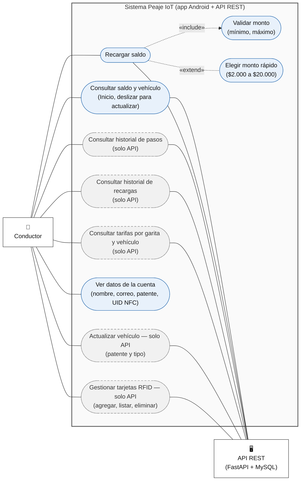
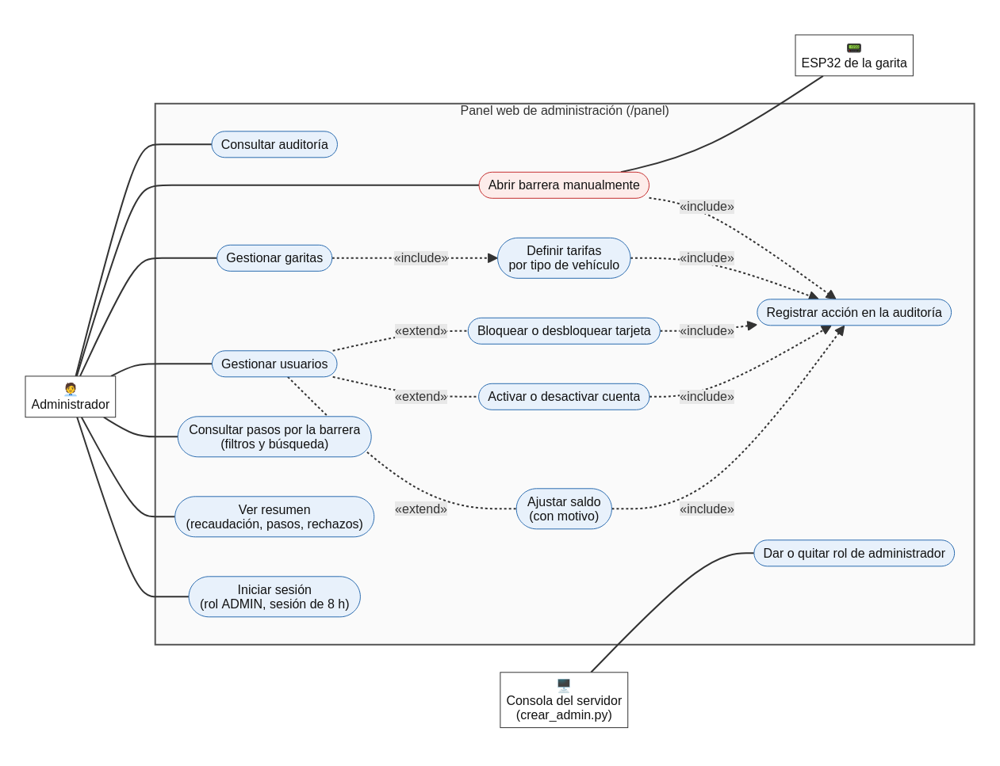
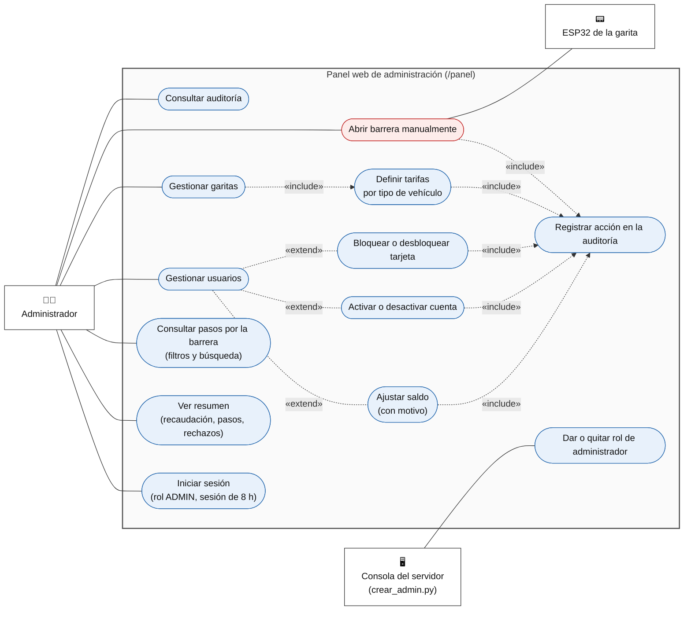

# Diagramas de casos de uso — Peaje IoT

Cada diagrama está en tres formatos: `.mmd` (fuente Mermaid, editable), `.svg` y `.png`.

**Leyenda:** óvalo azul = caso de uso implementado en la app · óvalo gris con borde punteado = disponible solo en la API REST
(no tiene pantalla en la app) · verde = barrera abierta · rojo = flujo alternativo o de rechazo ·
flecha punteada = relación «include» / «extend».

## Diagrama general del sistema

Actores: conductor y ESP32 de la garita. Resume todos los casos de uso del sistema.

Código Mermaid

## Login y autenticación (sección 3.1)

Registro de cuenta e inicio de sesión con validación de campos, verificación bcrypt y token JWT; bloqueo tras 3 intentos fallidos, manejo de errores y expiración de la sesión.

Código Mermaid

## Pago en la barrera y conexión IoT (sección 3.2)

Pago por NFC o RFID, cobro según tipo de vehículo en el worker MQTT, apertura o rechazo de la barrera.

Código Mermaid

## Cuenta, saldo y consulta de datos

Consulta de saldo, recargas y datos de la cuenta, junto con las funciones disponibles en la API.

Código Mermaid

## Administrador (panel web)

Panel web en `/panel` para cuentas con rol ADMIN: resumen, pasos, usuarios (ajuste de saldo, activar o desactivar cuentas, bloquear tarjetas), garitas y tarifas, apertura manual de la barrera y auditoría. El rol se otorga solo desde la consola del servidor.

Código Mermaid

